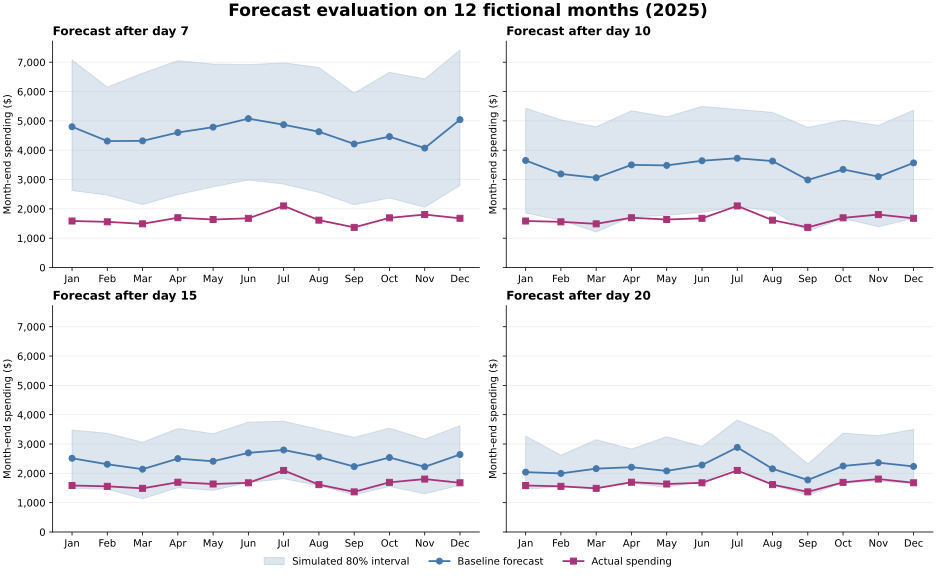

# Budget Calculator

A Python command-line expense tracker with SQLite storage, exact money values,
category reports, monthly summaries, and monthly spending limits.

## Project progression

This repository keeps each published milestone visible:

| Version | What it demonstrates | Explore |
| --- | --- | --- |
| v0.1 — Original calculator | Single-file Python app, CSV storage, input prompts, and 9 tests | [Archived source](archive/v0.1/) · [Original repository snapshot](https://github.com/ssalemnoone-ops/budget-tracker/tree/d02e5515cca4356f98f5cf7b77a1efb8fb059ed9) |
| v0.2 — SQLite and analysis | Separate modules, exact money handling, SQLite migration, edit/delete, spending reports, and 86 tests | [Update snapshot](https://github.com/ssalemnoone-ops/budget-tracker/tree/22b993c70184f08226d0899c0f9fe948077ef862) · [Changelog](CHANGELOG.md) |

| v0.3 — Forecast evaluation | NumPy simulations, cutoff-safe SQLite queries, and a reproducible fictional-data experiment, and 94 tests | [Results and chart](reports/v3/REPORT.md) · [Experiment script](evaluate_forecasts.py) |

[Compare v0.1 to v0.2](https://github.com/ssalemnoone-ops/budget-tracker/compare/d02e5515cca4356f98f5cf7b77a1efb8fb059ed9...22b993c70184f08226d0899c0f9fe948077ef862) to see how the implementation evolved.
The current application is at the repository root. The archive preserves the original
code and tests unchanged; the full commit history remains available.

## Run

Requires **Python 3.10 or newer**. On macOS or Linux:

```sh
git clone https://github.com/ssalemnoone-ops/budget-tracker.git
cd budget-tracker
python3 -m venv .venv
source .venv/bin/activate
python -m pip install -r requirements-dev.txt
python budget.py
```

Run the tests with `python -m pytest -q`. To install just the application,
use `requirements.txt` instead of `requirements-dev.txt`.

### Try fictional sample data

In a fresh clone, **before the first launch**, optionally copy the examples:

```sh
cp examples/budget.sample.csv budget.csv
cp examples/budgets.sample.json budgets.json
python budget.py
```

The app imports these fictional records once. If you skip this step, it starts
with an empty database. Keep real financial data local; `.gitignore` excludes
runtime databases and legacy data files.

Python provides `sqlite3`; no database server or extra database package is needed.
Runtime dependencies are `tabulate` and `numpy`; tests use `pytest`.

## Menu

1. Add expenses
2. Total expenses
3. View expenses, including their IDs
4. Quit
5. Category totals and percentage shares
6. Monthly spending totals
7. Set or update a monthly budget (`YYYY-MM`)
8. Monthly budget status and category shares
9. Edit an expense by ID (re-enter its four fields; EXIT cancels)
10. Delete an expense by ID (requires typing YES)
11. Forecast month-end spending
12. Backtest the baseline against completed months

Dates use `YYYY-MM-DD`. Amounts must be positive with at most two decimal places.
Category percentages are rounded for display and may not add to exactly 100%.
Monthly limits are independent and do not roll over.

## Storage and migration

`budget.db` lives beside `storage.py`, independent of the launch directory.
On startup, the application creates its tables and imports `budget.csv` and
`budgets.json` from that directory once. Both old files are preserved unchanged.
Subsequent changes are saved only in SQLite; editing the old files will not update
the database. A migration marker prevents duplicates even after restarting.
Identical legitimate expenses in the CSV remain separate records.

If legacy data is invalid, the import rolls back without partial records or a
completion marker. Fix the original file and restart. Automatic import refuses to
mix legacy records into an already populated, unmarked database.

Back up `budget.db` while the app is closed. It contains personal financial data.
Deleting an expense from the running app is permanent; cancellation leaves it
unchanged. Legacy files are historical snapshots, not current backups.

## Code structure

| File | Responsibility |
| --- | --- |
| `budget.py` | Menus, prompts, formatting, and delete confirmation |
| `storage.py` | SQLite schema, inserts, queries, updates, deletes, migration |
| `legacy_import.py` | Read the preserved CSV and JSON for migration only |
| `analysis.py` | Calculations on expense dictionaries in memory |
| `forecast.py` | Baseline forecast, bootstrap simulation, and backtest |
| `evaluate_forecasts.py` | Generate fictional spending and reproduce evaluation artifacts |
| `validation.py` | Parse amounts and months |
| `tests/` | Temporary databases and behavior tests; never use personal data |
| `SQL_GUIDE.md` | Beginner walkthrough of the actual database code |

SQLite stores money as integer cents (1250 means $12.50). Loading converts it back
to `Decimal`, so existing analysis functions still work. Each expense has a unique
ID which stays unchanged when edited. `monthly_budgets.month` is a primary key,
so setting a limit again updates that month rather than creating a duplicate.

All variable query values use `?` placeholders. Successful writes commit; failures
roll back and connections always close. Reports still aggregate in Python; moving
storage to SQLite does not automatically change their O(n) time complexity.

## Development history

See [CHANGELOG.md](CHANGELOG.md) for the published milestones and
[SQL_GUIDE.md](SQL_GUIDE.md) for a beginner walkthrough of the database code.


## Spending forecasts

Option 11 takes the last fully logged date. SQLite sums expenses by date through
that cutoff. Days without entries count as zero, so choose a month you have
tracked since its first day. The baseline scales average spending per elapsed
calendar day to the full month. After seven elapsed days, NumPy samples observed
days with replacement to produce 5,000 possible month-end totals. The report
shows their 10th and 90th percentiles and, when a budget exists, the fraction
strictly above it. The random seed is fixed so the same input gives repeatable results.

The model treats daily spending as independent and assumes future days resemble
observed days. It does not schedule recurring bills or account for weekday effects.
The interval describes the simulated distribution, not a measured coverage rate.

Option 12 evaluates the baseline on day 10 of each completed month in a period
you confirm is fully logged. It compares each forecast against the actual month
total and reports mean absolute error in dollars. Later dates in each month
supply the actual total, never the day-10 forecast. This is a replay based on
current transaction dates. It cannot reconstruct what had been entered or edited
at an earlier point in time.


## Version 3 evaluation

[Read the experiment report](reports/v3/REPORT.md) for baseline forecast errors,
simulated interval coverage and widths, and limitations on 12 fictional months.
The experiment evaluates days 7, 10, 15, and 20 using temporary SQLite storage.

```sh
python -m pip install -r requirements-dev.txt
python evaluate_forecasts.py
```



The original and SQLite milestones remain linked above. The current results are
an exploratory synthetic-data benchmark. They demonstrate the evaluation process
and reveal problems caused by resampling recurring bills as independent days.
