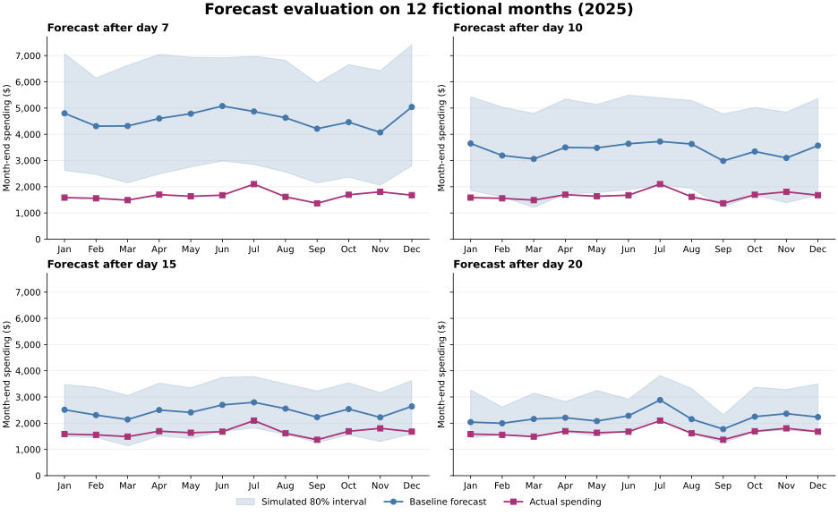

# Version 3 forecast evaluation

**All data and results on this page come from fictional spending.** This experiment
assesses the current method on one specified generator. It does not establish its
accuracy for a real person's budget.



## Results

| Cutoff day | Months | Baseline MAE | Baseline bias | 80% interval coverage | Mean interval width |
| --- | --- | --- | --- | --- | --- |
| 7 | 12 | $2,940.32 | $2,940.32 | 0.0% | $4,232.42 |
| 10 | 12 | $1,747.52 | $1,747.52 | 50.0% | $3,490.28 |
| 15 | 12 | $805.51 | $805.51 | 91.7% | $1,963.27 |
| 20 | 12 | $545.15 | $545.15 | 75.0% | $1,509.98 |

MAE is mean absolute error in dollars. Bias averages forecast minus actual, so
positive values indicate overprediction. Coverage is the fraction of actual month
totals inside the lower and upper endpoints, inclusive. Each row contains only
12 months, so one hit changes coverage by 8.3 percentage points. The four cutoff
rows reuse the same months and are dependent evaluations.

The largest baseline miss occurred in 2025-06 at day 7.
It forecast $5,076.60 against $1,677.10 actual spending,
an absolute error of $3,399.50.

## Data and experiment design

- Fixed data seed `20261118` and calendar year `2025`.
- 334 fictional transactions and 122 zero-spending calendar days.
- Rent of $900 on day 1, streaming of $12 on day 8, and phone service of $45 on day 18.
- Daily grocery probability 0.38, dining probability 0.45 on weekends and 0.15 on
  weekdays, and transit probability 0.18. Amounts are generated as integer cents.
- One additional purchase between $150 and $400 in March, July, and November,
  randomly scheduled on day 12 or later.
- All calendar days are fully observed. Missing transaction dates mean zero spending.
- Every cutoff uses only that month's days 1 through the cutoff, inclusive.
- 5,000 simulation paths for each cutoff, with seed `20261118 + month * 100 + day`.
- The model uses the same functions as the application. SQLite groups transactions
  by date and filters the forecast inputs before they reach NumPy.

## How the experiment works

`evaluate_forecasts.py` creates a disposable SQLite database and inserts the generated
transactions. A separate query obtains the actual full-month total for scoring.
Forecast queries end on the cutoff date, preventing later spending from entering
predictions. Zero-spending days are filled in by the forecasting code.

The baseline multiplies observed spending by days-in-month / elapsed-days.
The bootstrap samples observed daily amounts with replacement for each remaining
day, adds spending already observed, and takes the 10th and 90th percentiles.
Its expected point forecast equals the baseline mathematically. This experiment
therefore evaluates baseline point accuracy alongside the bootstrap's interval
coverage and width. It does not claim a second, superior point forecasting model.

## Findings and limitations

Across these months, baseline MAE falls from $2,940.32 at day 7 to
$545.15 at day 20. Every baseline prediction exceeds its actual
monthly total. Interval coverage is 0.0% at day 7,
50.0% at day 10, 91.7% at day 15, and
75.0% at day 20. Coverage does not improve monotonically.

Rent arrives at the beginning of every month. Scaling that early total to the
whole month overpredicts spending. Resampling daily totals can select the rent day
multiple times, producing very wide simulated ranges. Coverage must be assessed
alongside interval width. A wide interval can cover actual spending while offering
little precision. The reported coverage is measured on these fictional months,
and the label 80% is the simulation's nominal level.

The generator also includes weekday effects and occasional future purchases.
Independent sampling misses those patterns and cannot anticipate a large expense
that has no analogue among the days already observed. Estimates may improve later
in a month, but that pattern needs to be measured for each dataset.

The fixed generator and seed make the run reproducible. Repeated runs using that
same seed are not independent validation. There are no fitted parameters or tuning
steps, and these months are an exploratory benchmark. A next model could schedule
known bills separately from variable daily spending, then be evaluated on fresh
synthetic seeds and fully logged real months.

## Reproduce

From the project root, with its virtual environment active, run

```sh
python -m pip install -r requirements-dev.txt
python evaluate_forecasts.py
```

The output directory defaults to `reports/v3`. Use `--output-dir /tmp/budget-report`
to write a separate copy. The script uses temporary SQLite storage and generates
all of its own data. It never opens the application's personal `budget.db`.

Outputs include `synthetic_expenses.csv`, `predictions.csv`, `summary.csv`, this
report, and PNG/SVG charts. The CSV files retain unrounded metric values. Displayed
dollars are rounded to cents. Inspect `environment.txt` for package versions.
